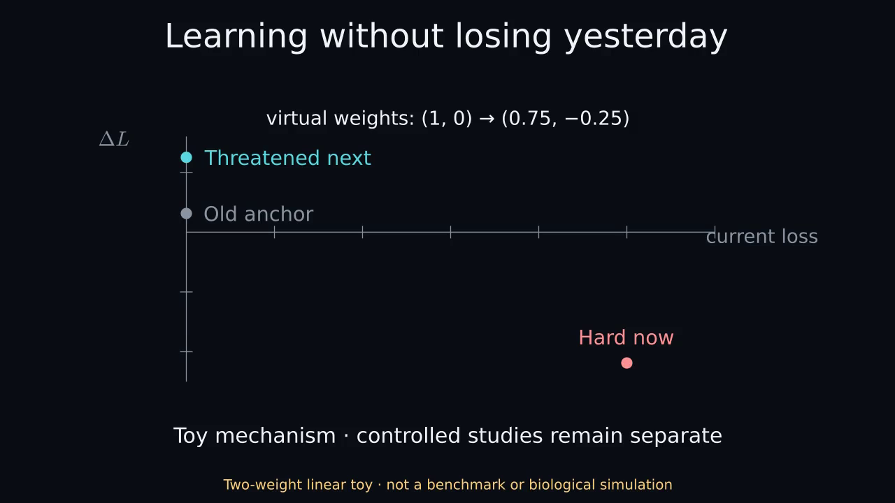

# Learning and Remembering

What helps a small neural network learn something new without losing what it already knows? And when we give a network separate computational roles, do activation interventions become easier to interpret?

This repository studies those questions through small, reproducible experiments. The replay studies separate **which examples stay in memory** from **which stored examples are rehearsed**. A separate synthetic study examines supplied boundaries between current evidence, retrieved evidence and context control.

## Start here

- [Learn the ideas with a tiny working example](docs/START_HERE.md). The guide explains forgetting, replay buffers and the difference between current error and predicted interference.
- [Read the research overview](docs/RESEARCH_OVERVIEW.md) for hypotheses, controls, related work and open questions.
- [Choose an evidence question and reproduction level](docs/EVIDENCE_MAP.md): connect the later JOINT/decomposition diagnostics to the original results, with saved-check versus inference/training routes.
- [Read the earlier Fashion-MNIST replay-selection report](studies/replay-selection-fashion-mnist/results/evaluation-report-public.md), then inspect its [protocol and evidence guide](studies/replay-selection-fashion-mnist/README.md).

## New empirical result: PenDigits recurrent replay

[Thirty newly trained MLPs on PenDigits](studies/pendigits-recurrent-replay/README.md) did not support MIR over uniform replay: final macro accuracy 78.48% versus 79.94%, difference −1.46 percentage points, paired-seed 95% bootstrap interval [−3.16, +0.33]. Current-pair acquisition was 7.88 points lower with MIR. The interval crossing zero is not proof of equivalence or confirmed inferiority. High-loss reached 85.65% descriptively, not as a confirmed winner. [Full report and limitations](studies/pendigits-recurrent-replay/REPORT.md), [frozen protocol](studies/pendigits-recurrent-replay/PROTOCOL.md), and [reproduction levels](studies/pendigits-recurrent-replay/README.md#what-is-bundled) preserve all adverse findings. This is a small trajectory-classification pilot, not an LLM or deployment benchmark.

For read-only checks that remain active under Python optimization, use the
[fail-closed PenDigits evidence checker](docs/PENDIGITS_EVIDENCE_CHECKS.md).
It also checks completion consistency, recurrence/old-class arithmetic and CSV
agreement without rewriting frozen evidence or changing the negative result.

## Watch the narrated explanation

[](docs/animations/narrated/concept.mp4)

[53.7-second narrated MP4](docs/animations/narrated/concept.mp4) · [Complete transcript](docs/animations/narrated/transcript.txt) · [Captions](docs/animations/narrated/captions.vtt) · [Editable source and reproduction](docs/animations/narrated/RENDERING.md)

Speech-led Manim animation with a synthetic stock voice. Offline linear toy · not benchmark evidence. This is an explanatory upgrade, not a new experimental result. Captions have approximate sentence timing. The [static-first viewer](docs/animations/narrated/index.html), poster and complete transcript provide a no-motion alternative. The original silent version and its historical QA remain unchanged below.

## Watch the concept in 24 seconds

[](docs/animations/concept.mp4)

[24-second Manim MP4](docs/animations/concept.mp4) · [Optional GIF preview](docs/animations/concept.gif) · [Text transcript](docs/animations/transcript.txt) · [Captions](docs/animations/captions.vtt)

Rendered with Manim Community 0.22.0. Offline linear toy · not benchmark evidence. No audio. The poster and transcript provide a no-motion alternative. The downloaded [HTML viewer](docs/animations/index.html) is static by default and never autoplays.

## What the experiments found

**Keeping historical coverage helped in the digit stream.** Across ten paired seeds, final macro accuracy was 88.44% for reservoir replay, 21.16% for equally sized FIFO memory and 19.70% for current-only repetition. Immediate acquisition was strong in every arm. The [digit report](docs/replay_results.md) links the selection lock, all development/evaluation runs and reproduction instructions.

**More elaborate selection did not clear the Fashion-MNIST study's support criterion.** Across 20 paired seeds and 100 runs, maximally interfered retrieval (MIR) exceeded high-loss replay by 0.6265 percentage points; the paired 95% bootstrap interval was −0.3595 to +1.5330 points. The primary result is inconclusive. Uniform replay had a higher descriptive mean, and the prespecified protection audit was adverse to MIR. [All results and compute controls](studies/replay-selection-fashion-mnist/results/evaluation-report-public.md) are retained.

**Engineered role boundaries affected both prediction and interventions.** The [six-architecture pilot](docs/results.md), [equal-parameter role controls](docs/role_controls.md) and [validation-matched competence study](docs/competence_controls.md) trace this dependence. Matching was incomplete, and one intervention diagnostic follows algebraically from the supplied masks. A competence-independent interpretability advantage remains unestablished.

These are task-specific computational findings. The [biological evidence map](research/replay-mechanism-map.md) explains the motivation and where the analogy ends.

## Reproduce

The commands below retrain the **synthetic pilot**, not every study. For no-training evidence checks or study-specific inference/recomputation, use the [reproduction-level guide](docs/EVIDENCE_MAP.md#5-choose-a-reproduction-level-before-running-a-command).

With Python and NumPy already available, from the repository root:

```sh
bash scripts/run_pilot.sh --output results/local-reproduction
PYTHONPATH=src python scripts/verify_run.py results/pilot \
  --allow-missing-checkpoints --compare results/local-reproduction
PYTHONPATH=src python -m unittest discover -s tests -v
```

The recorded runtime was Python 3.12.14 with NumPy 2.3.5; `requirements.txt` pins NumPy. These commands perform no downloads. Use a fresh output directory. The text-only pilot publication omits binary checkpoints; [availability and regeneration](docs/checkpoints.md) explain that boundary. The [verifier correction](docs/audit_coverage_fix.md) documents its exact-coverage checks. Each real-data study has separate setup and evidence-verification instructions.

## Next questions

Would replay help when classes recur naturally? Can a selection audit predict protection under the learner's actual joint update? Do role effects survive interventions that lack a designed-in alignment? The [delayed-memory proposal](docs/next_experiment.md) and [replay mechanism map](research/replay-mechanism-map.md) describe prospective work; their proposed experiments remain unrun.

[Design](docs/design.md), [claim matrix](docs/claim_matrix.md), [source](src/functional_circuits), [tests](tests) and [provenance](docs/provenance.md) provide the audit trail. Original code, generated data, trained weights and original documentation are [MIT licensed](LICENSE). External datasets, dependencies and papers retain their own licenses and attribution requirements.

## Post-hoc JOINT replay diagnostic

[Same-state update-composition diagnostic and complete signed outputs](studies/replay-joint-update-diagnostic/README.md) find that the local MIR-versus-high-loss contrast changes sign between deployed JOINT and sequential updates. Important adverse context: MIR still raises old-panel loss by +0.71271 nats from the original state and raises new-panel loss by +0.37056 versus fresh-only SGD. These are conditional one-step findings from four reused historical seed clusters, not fresh confirmation, future-retention evidence or a general plasticity advantage.

[Portable rerun inputs and independently checked saved numerical reproduction](studies/replay-joint-update-reproduction/README.md) are available as an additive package. This reproduces the same historical diagnostic, not fresh confirmation, and leaves its adverse findings unchanged.

## Historical 2×2 replay update decomposition

[Complete signed component diagnostic and saved-evidence verification](studies/replay-update-decomposition/README.md) separate combined weighting from replay-gradient location on four additional historical seed clusters. JOINT MIR still increases old loss by +0.905519 nats; its −0.025069 MIR-minus-high-loss contrast does not clear the frozen −0.005 interval margin. The +0.517077 interaction is a local arithmetic finding, not robust retention efficacy or a biological mapping. Both fresh-control scales and all adverse new-class results are retained.

