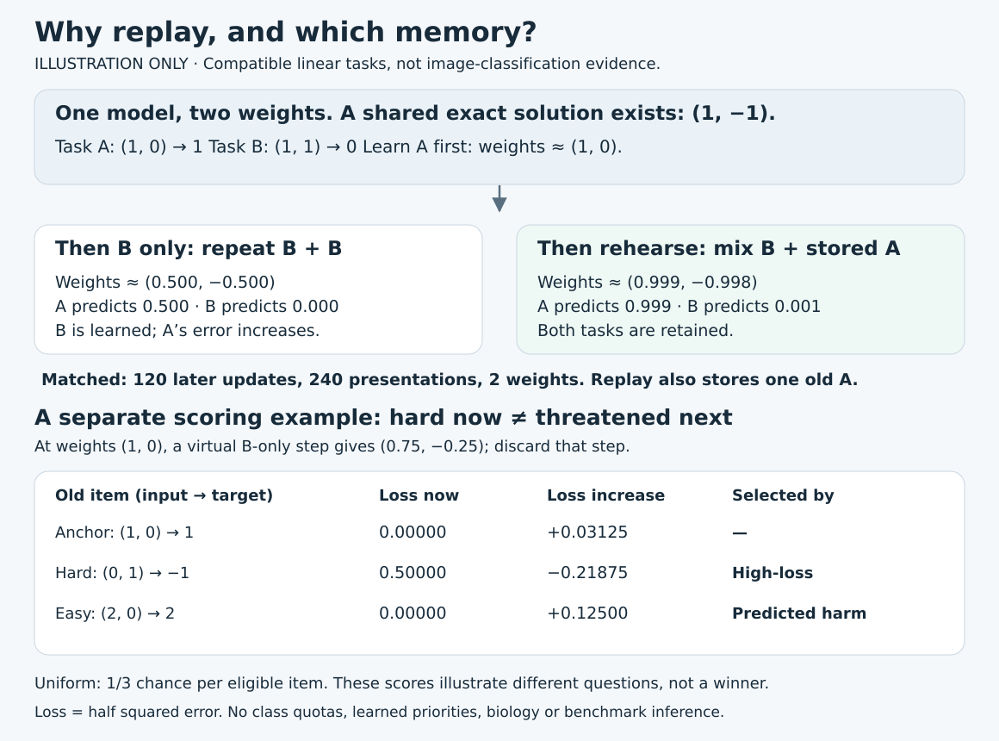

# Start here: learning without losing yesterday

**For a curious Python/ML learner.** Start with the five-minute toy below, then follow the links to the measured studies. You do not need neuroscience background. The toy is an illustration, not new benchmark evidence.

## 1. The problem in plain English

A classifier learns shoes today after learning shirts yesterday. Its weights are shared: updates that help shoes can damage shirt predictions. **Forgetting** is a loss of earlier performance after new learning. It is different from never learning the shirts in the first place.

**Replay**, also called rehearsal, mixes stored old examples into later updates. A **buffer** is the limited collection of examples available for replay. Two questions are distinct:

1. Which examples remain in the buffer?
2. From those available, which examples should be rehearsed next?

The [handwritten-digit study](replay_results.md) mainly tests the first question. The [Fashion-MNIST study](../studies/replay-selection-fashion-mnist/README.md) tests the second while matching buffer contents and class coverage.



The figure's numbers come from the offline toy, not the published image-classification experiments.

## 2. Work through one tiny learner

Our linear model predicts y = w1 × x1 + w2 × x2. Its two tasks are:

- A: input (1, 0), target 1.
- B: input (1, 1), target 0.

These tasks are compatible: weights **(1, −1)** solve both exactly. We are not asking a model to give contradictory answers to the same input.

Starting from zero, learning A gives approximately (1, 0). Later, using only B gives approximately (0.5, −0.5): B is learned, but A now predicts 0.5 instead of 1. Rehearsing A alongside B gives approximately (0.999, −0.998), retaining both. The script reports **loss**, here half the squared prediction error, not classification accuracy.

Run from the repository root with Python 3, standard library only:

```sh
python -B examples/learning/replay_demo.py
python -B -m unittest discover -s examples/learning -v
```

Read [the short script](../examples/learning/replay_demo.py) and [its tests](../examples/learning/test_replay_demo.py). Both conditions use two weights, 120 later updates and 240 later example presentations. Current-only presents B twice per update; replay presents B plus stored A. Replay has **one extra stored old example**, and fewer B presentations. Matching update count does not erase that memory/data-access difference. This carefully constructed example demonstrates a possibility, not the size of a real-world replay benefit.

### Hard now is not the same as threatened next

The script also scores three old examples at weights (1, 0), before a hypothetical B-only step to (0.75, −0.25). All three labels obey the same rule y = x1 − x2.

- Uniform selection gives each eligible item an equal chance. The toy prints probabilities, so no randomness is needed.
- High-loss selects the item the model currently gets most wrong: input (0, 1), target −1, loss 0.5.
- Predicted-interference selection asks which old item a new-data update would hurt most. Input (2, 0), target 2 has zero current loss, but its loss would rise to 0.125. The hard-now item's loss would actually decrease.

This illustrates the scoring distinction behind **maximally interfered retrieval (MIR)**, an existing method. The hypothetical update is discarded. MIR ranks signed loss differences: if all are negative, it chooses the least negative rather than clipping them to zero. It is not a complete MIR implementation, a selector comparison, or the Fashion-MNIST loss function. A high predicted risk is also not a guarantee that rehearsing the item will improve later performance.

## 3. How the real experiments separate explanations

### Is historical coverage helping, or is the model simply failing to learn?

In the [digit experiment](replay_results.md), a **reservoir** gives earlier stream observations a chance to remain in a 100-example buffer. **FIFO**, first in/first out, retains the most recent examples instead. Under the imposed class-blocked stream, recent-only memory loses access to earlier classes.

Across ten paired seeds, final macro accuracy was 88.44% with reservoir replay, 21.16% with FIFO, and 19.70% with current-only repetition. Macro accuracy here averages recall across classes, giving each class equal weight. Immediate acquisition was above 97% in every arm: the weak final scores were not simply failure to learn the current block. Network size, initialization and update counts were matched within each seed; reservoir and FIFO also shared the same buffer capacity. This supports historical coverage in this particular class-shift setup, not an optimal memory policy everywhere.

### Does predicting interference improve which memories get replayed?

The [locked Fashion-MNIST report](../studies/replay-selection-fashion-mnist/results/evaluation-report-public.md) compares uniform, high-loss, MIR and shuffled-MIR selection, plus a useful-compute uniform control. The four diagnostic arms share a 200-item reservoir policy, candidate IDs, per-class replay counts, model size and update/presentation budgets. Their weights diverge as they learn. The shuffled control keeps the score distribution within each class but breaks the score-to-example association: does assigning the right score to the right item matter?

Across 20 paired evaluation seeds and 100 runs, MIR averaged 70.8425% final macro accuracy versus 70.2160% for high-loss. The primary difference was **+0.6265 percentage points**. Its paired 95% bootstrap interval, −0.3595 to +1.5330 points, includes both a small disadvantage and a useful advantage. This resamples seed-paired differences on one fixed dataset; it does not measure uncertainty across new visual domains. The advance rule required an average gain of at least 1 point and an interval entirely above zero. Neither happened. **The result is inconclusive, not proof that the methods are equal or that MIR has no effect.**

Uniform averaged 72.1355%; useful-compute uniform averaged 75.3325%. These are descriptive secondary comparisons. The useful-compute arm spends saved scoring work on extra replay, uses more updates/presentations and a separately selected rate. It does not isolate selection alone or establish equal wall-clock efficiency. A separate old-class-loss audit was adverse to MIR's proposed protection story, but its sequential audit updates differ from the learner's joint update.

## 4. Inspect evidence before spending compute

For the later JOINT diagnostic, its portable reproduction and the 2×2 update decomposition, use the [evidence map](EVIDENCE_MAP.md). It explains why their one-step loss comparisons do not replace the original final-accuracy result and labels what can be checked without training.

- Fashion-MNIST: follow [the study's reconstruction and verification instructions](../studies/replay-selection-fashion-mnist/README.md). Reconstructing saved evidence and reproducing saved predictions are different from retraining. The public export has explicit redaction and verification limits.
- Digits: [results and evidence links](replay_results.md) include all selection trials, held-out outcomes, matched budgets and exact-repeat qualifications.
- The separate synthetic role study asks about supplied architectural boundaries, not learned replay. Use [the root README's study navigation](../README.md) to reach its pilot and controls. Its role masks are engineered, not discovered brain regions.
- For biological motivation, read [the replay mechanism evidence map](../research/replay-mechanism-map.md). Biological reactivation motivates questions; it does not establish that a reservoir, supervised error score, or virtual gradient is a faithful brain mechanism. No biological fidelity was demonstrated here.

## Useful next questions

1. Would the coverage advantage persist when classes return naturally instead of arriving in blocks?
2. Does a selector help under another frozen dataset, buffer size and learning-rate design, with the same coverage controls?
3. Can a prospective audit predict actual protection under the very update used by the learner?

These are questions for future controlled studies, not results already obtained. The toy, the measured classifier studies and the biological literature are three different evidence levels.
